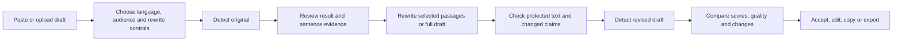

# HumixAi product blueprint

Prepared: 10 November 2026 (Asia/Dhaka)

Status: product direction and implementation roadmap. Core studio and platform modules have since been implemented; see [implementation status](implementation-status.md) for working functionality, required external setup and remaining roadmap projects. The repository findings below describe the initial audit, not the current implementation.

## Product direction

HumixAi helps people understand AI signals in a draft, improve the writing in their own voice, and review what changed before publishing or submitting it.

Suggested promise: **Write naturally. Keep your meaning. See the evidence.**

The core product is one document workspace, with three actions:

- **Detect AI:** analyze a document and inspect the result.
- **Humanize / Improve:** revise selected passages or the full draft under user-selected constraints.
- **Analyze & Improve:** run detection, rewriting, preservation checks and a second scan from one action, then show the comparison.

Initial audiences are writers/marketers and students editing their own drafts. Educators/editors get a review view with evidence, comments and reports. Reviewer workflows should not automatically rewrite someone else's submission.

## What the competitor notes establish

| Reference | Useful idea for HumixAi | Evidence boundary |
| --- | --- | --- |
| Walter Writes | Rewrite controls and a connected detect/improve workflow | Naturalness and detector-pass claims need independent testing. A low score is not proof of human authorship. |
| Proofademic | Academic review, sentence evidence, batch reports and paraphrase-aware detection | Do not describe HumixAi as Turnitin-equivalent or imply a partnership. Protecting APA/MLA citations will be our own tested feature. |
| Copyleaks | Evidence-rich detection, plagiarism/source reports and publisher/institution workflows | Only display a Copyleaks result when an actual authorized API request returned it. |
| GPTZero | AI/Human/Mixed results, advanced sentence evidence and writing-process reports | Its classifier confidence is not a measurement of the percentage of words written by AI. |
| Originality.ai | Integrated content checks, bulk/website scans, guidelines and team workflows | Its product is broader than short-form scanning. Its 5.0 release changed score meaning to estimated AI involvement. |

The user's best-overall rankings are useful hypotheses about experience and target audiences, not established accuracy rankings. A defensible comparison needs the same labelled samples, languages, domains, model versions and scoring rules. [RAID research](https://aclanthology.org/2024.acl-long.674/) illustrates why broad detector claims require robust evaluation.

Official references: [Walter](https://walterwrites.ai/), [Proofademic](https://proofademic.ai/), [Copyleaks](https://copyleaks.com/ai-detector), [GPTZero](https://gptzero.me/), [Originality.ai](https://originality.ai/).

## The percentage contract

Percentage results are possible, but the UI must preserve what a detector actually measures.

| Value | Meaning | Display rule |
| --- | --- | --- |
| Class probability/confidence | How strongly the model supports an AI, Human or Mixed classification | Name the class and explain the score. Do not call it a percentage of AI-authored words. |
| Estimated AI involvement | A provider's estimate of how much a text involves AI | Label it as an estimate and retain the provider's definition. |
| Highlight coverage | Flagged characters divided by analyzed characters, using a documented rule | Label it as highlighted text coverage, separate from authorship. |
| Style signals | Repetition, sentence variety, readability and similar measurements | Present as writing feedback. Do not convert arbitrary heuristic weights into calibrated probability. |

Use the provider's genuine uncertainty fields when available. If confidence is unavailable, say so; do not invent a confidence badge. Show analyzed coverage, supported language, scan time, document revision and detector/model version when available.

Do not derive a Human percentage as `100 - AI` when the provider has a separate Mixed class. Do not average incompatible provider scores into a supposedly authoritative final percentage. Multi-provider results can be displayed separately with agreement/disagreement explained.

Short, unsupported-language or partially analyzed text must have an explicit limited/insufficient-evidence state. Avoid a fabricated precise result. Sentence highlights indicate signals contributing to a result, not proven AI authorship.

Sources: [GPTZero API output](https://gptzero.me/developers), [GPTZero Advanced Scan interpretation](https://support.gptzero.me/articles/7549392421-how-do-i-interpret-results-from-gptzero-s-advanced-sentence-scanning), [Originality.ai 5.0 release, 9 November 2026](https://originality.ai/blog/introducing-originality-5-0-and-max).

## Main user flow

The one-step action runs the same stages automatically after the user selects their settings. A user may stop after detection or request improvement without an initial scan.

1. **Import:** paste text or upload a supported file; preview extracted text before scanning. Keep paragraphs, headings and lists.
2. **Set intent:** choose Academic, Professional, Casual or Marketing, rewrite strength, target length and protected passages.
3. **Analyze:** show a real provider result, sentence evidence where supplied, and any limits.
4. **Improve:** preserve user intent, fix robotic phrasing and repetition, and adapt tone. Explain substantial changes.
5. **Validate:** check protected quotations, citations, names, numbers, dates, URLs and terms. Flag changed or added claims for review.
6. **Recheck:** scan the exact revised version with the same detector/model/configuration when possible. If they differ, label the comparison accordingly.
7. **Compare:** show original/revision, a readable diff, preservation findings, quality feedback and both scan results. A result can improve, stay the same or get worse.
8. **Finish:** accept changes individually or together, restore the original, save a revision, copy or export.

Changing text makes its previous scan stale. A failed recheck leaves a usable draft labelled **Recheck unavailable**; it never implies a successful score reduction. A score reduction also does not turn AI-assisted writing into evidence of human authorship.

## Combined feature roadmap

| Feature family | First useful release | Expansion |
| --- | --- | --- |
| Document studio | Paste/TXT input, responsive dual panels, word count, source/revision diff, copy/download | DOCX and text-PDF import with preview, URL import, rich structure export, OCR later |
| Detection | One real provider, accurately labelled score, sentence spans where supplied, explicit errors/limits | Optional second opinion, long-document coverage, paraphrase/mixed-content evaluation, proprietary calibrated model |
| Humanizing | Selected/full-text revision, tone/strength/length controls, protected passages | Opt-in personal voice, brand voice and audience profiles |
| Preservation | Exact protected-span checks, citation/quotation/number checks and changed-claim flags | Reference-list consistency, technical terminology and stronger meaning review |
| Quality checks | Readability and actionable grammar/style feedback, clearly separate from AI detection | Dedicated grammar/spelling, content quality, custom style guidelines |
| Sources | Preserve existing citations and links | Plagiarism/source matching, citation verification, fact/hallucination review with sources |
| Reports | Before/after results and plain-text export; PDF/shareable reports after saved documents | Full audit trail, batch summaries, website/sitemap reports |
| Accounts | Authentication, document ownership, optional history, deletion controls and usage display | Plans, billing, credit top-ups, teams/roles and shared workspaces |
| Scale | Bounded jobs, timeouts, stage progress and cost limits | Batch upload, queues, team analytics and scheduled website checks |
| Language | Claim support only for language/task pairs actually evaluated | Bengali, English and mixed-language quality with separate detection and rewriting evaluations |
| Integrations | Internal provider abstraction | Public API/webhooks, browser extension, Google Docs, LMS, WordPress, Zapier/MCP and mobile clients |
| Process evidence | Revision history and change log, described as history | Opt-in typing/replay and contribution reports; do not misrepresent imported text as recorded writing |
| Media and governance | Outside the initial text release | Image/voice/video/deepfake detection, image plagiarism and moderation as separate modules |

This roadmap combines feature families without assuming that every competitor capability is available in its browser app. Some Walter/Proofademic tools are API-only or announced for later release. Integrations and resale/white-label terms must be checked before launch.

## Ideas that can distinguish HumixAi

### 1. Preserve the writer's voice

Let the user optionally supply their own writing samples. Show a preview of tone/style preferences, let them edit those preferences, and support sample deletion. Start with session-only samples; persistent voice profiles require explicit opt-in.

### 2. Show quality alongside detector results

A successful revision should be clearer and faithful to the original. Display separate findings for detector output, readability, protected text and changed claims. Never make a lower detector score the sole success criterion.

### 3. Keep specific text unchanged

Users can lock sentences, citations, quotes, numbers, names, product details and specialist vocabulary. Highlight any lock violation and prevent silent acceptance. Semantic checks are fallible, so describe them as review assistance rather than guaranteed meaning preservation.

### 4. Support Bengali and English deliberately

Build Bengali punctuation/word handling, mixed-language editing and natural local phrasing. Evaluate detection separately from rewriting: a good Bengali rewrite does not establish reliable Bengali detection. Publish the supported tasks and known limits for each language.

### 5. Make long documents reviewable

Preserve the outline, let users approve paragraph-level changes and show exactly which sections were analyzed. When chunking is necessary, retain context and coverage. Do not describe an average of chunk scores as a calibrated full-document probability without evidence.

### 6. Help users add real specificity

Offer prompts such as “Add your own example”, “Explain what happened in your project” and “Choose the point you actually agree with”. This produces useful personalization without inventing personal experiences, quotations or supporting facts.

### 7. Explain decisions and retain the document journey

Show why an edit was suggested, what changed, which version was scanned and what checks were completed. Export a transparent record of revisions and AI assistance. This is stronger evidence about the process than a bare percentage, while still not proving authorship by itself.

## Initial repository audit: foundation and gaps before implementation

The current app uses PHP/Laravel, Blade/JavaScript and Gemini. It already has detect/humanize/combo routes, a percentage gauge, sentence heatmap, rewrite modes, basic citation tokenization, before/after results, a diff and text/print export.

However, it is currently a prototype rather than a validated detector:

- `app/Services/AiDetectorService.php` requests simulated competitor scores from Gemini; its offline path creates branded scores using fixed multipliers. No actual five-provider scans are performed.
- The offline detector uses English-oriented writing heuristics and hand-selected weights. They are not a trained/calibrated detector. One-sentence inputs receive a large uniformity penalty, creating an important false-positive risk.
- `app/Services/AiHumanizerService.php` uses Gemini when available and fixed substitutions otherwise. Re-scoring uses the same detection layer; this does not verify external-detector performance.
- Citation protection is a limited pattern-based mechanism; there is no complete preservation/claim validation stage.
- The current app does not implement persisted document accounts/history, uploads, plagiarism search, teams, credit billing, batch queues or real competitor integrations.

The existing UI can be reused. The main technical change is replacing invented scoring with a real detection adapter and building reliable document/revision handling around it.

Before public deployment, address the exposed server-key update route, public cache-clearing route, secret-printing console command, unsafe diff HTML rendering, missing input/usage caps and provider-failure labelling. These findings were identified by source inspection; no exploit or live API test was performed.

The repository already contained many uncommitted changes before this blueprint. They were not overwritten. No `.env` values were inspected.

## Implementation sequence

1. **Make the existing foundation truthful and safe:** consistent HumixAi branding, remove simulated branded results from production output, label heuristic writing signals accurately, restrict configuration changes, escape output and bound requests.
2. **Integrate one real detector:** compare available providers on representative samples and API terms. Add a replaceable server-side adapter rather than coupling the UI to a brand. Keep Gemini or another configured writing model for rewriting.
3. **Complete the core pipeline:** revision IDs, protected text, preservation checks, real recheck, robust diff and partial-failure states. Limit retries and estimated spend; do not repeatedly rewrite until an arbitrary target percentage is reached.
4. **Add product essentials:** authentication, owned documents/history/deletion, quotas, jobs/progress, file extraction preview, reports and billing when appropriate.
5. **Expand based on use:** plagiarism/citation/fact services, bulk/team/publisher workflows, evaluated Bengali support and integrations.
6. **Consider a proprietary detector:** collect licensed/consented labelled data and train/calibrate/evaluate a separate classifier. Merely asking a general LLM for a percentage is insufficient evidence of accuracy.

No need to buy/integrate all five detection providers for the first release. A well-evaluated detector plus a strong improvement/review workflow is a practical starting point. A second independent view can be a later optional deep scan, with clear cost and score semantics.

## Data and service boundaries

- Keep provider credentials on the server. Public users must not edit server environment settings.
- Bind every scan to a document revision/hash, analyzed coverage, language, provider, score definition, model/version if known, and completion state.
- Separate detection, rewriting, source search and quality checks behind service interfaces. Preserve raw provider output safely for diagnosis under a documented retention policy.
- Add bounded timeouts, idempotent jobs, validated response schemas, per-user rate/usage limits and stage-specific failures.
- A failed paid call must not be silently represented as success. Reconcile actual provider use; define which failed/retried stages consume user credits before billing launches.
- Explain external text processing before submission. Offer history opt-out/deletion and explicit consent for stored voice samples. Do not claim zero retention or zero training unless verified for each relevant provider configuration.
- Treat uploaded text as content, not application instructions, when sending it to a rewriting/review model.

## Acceptance and evaluation

Functional verification should use fake provider responses by default and cover:

- Score semantics, all supported result classes, absent confidence/version fields and incompatible provider comparisons.
- Short/unsupported inputs, file extraction coverage and stale scan detection after edits.
- Citations, quotations, URLs, names, numbers, negation, paragraph structure and user-locked text.
- Provider errors, malformed output, timeouts, partial pipeline completion, no-change/worse-score outcomes and bounded retries.
- Safe rendering of arbitrary draft/output text, document ownership and protected configuration routes.

The current feature tests can call Gemini if a key is configured. Mock providers before running integration-shaped tests; do not treat passing shape tests as detector validation.

For detector evaluation, keep held-out human, pure AI, mixed and revised-AI samples across intended languages, lengths and domains. Avoid train/test duplicate leakage and include previously unseen generators. Report human false-positive rate, AI recall, mixed-content performance and calibration where the score supports a probability interpretation. Report sample counts and per-language/domain results rather than a single unsupported accuracy claim.

For humanizing, measure blinded reader preference, meaning/claim fidelity, citation/number errors, formatting retention, latency and cost. Track detector changes as one observation, not proof of writing quality or authorship.

## Recommended first-release scope

**HumixAi Studio:** one trustworthy detection integration, sentence review where available, controlled humanizing, protected citations/terms, exact before/after versions, transparent recheck, copy/export and clear usage limits. Add accounts/history and file import as the first product-completion work.

Use the tagline and product promise around natural writing, preserved meaning and understandable evidence. Avoid “guaranteed 0% AI”, “passes every detector”, invented competitor results or a “#1 accuracy” claim before evidence exists.

This blueprint is the planning reference. The current implementation and verification boundary are maintained in [implementation status](implementation-status.md).
